# Tizim tahlili modellari

«Yangi alifbo» tizimining tizim tahlili modellari, oltita metodika boʻyicha. Mermaid diagrammalarini GitHub toʻgʻridan-toʻgʻri rasm qilib koʻrsatadi; IDEF0 va BPMN alohida fayllarda.

| Metodika | Nimani koʻrsatadi | Qachon tanlanadi | Ushbu hujjatda |
|---|---|---|---|
| **DFD** | Jarayon, maʼlumot ombori, tashqi obʼekt, oqim | Tizim tahlilining boshlanishi | [1-boʻlim](#1-dfd--maʼlumotlar-oqimi-diagrammasi): kontekst (0-daraja) va 1-daraja |
| **IDEF0** | Funksiya: kirish, boshqaruv, chiqish, mexanizm | Katta tashkilot jarayonlari | [2-boʻlim](#2-idef0--funksional-model): A-0 va A0 |
| **BPMN 2.0** | Jarayon bosqichlari, rollar, qarorlar | Buyurtmachi bilan kelishish | [3-boʻlim](#3-bpmn-20--biznes-jarayon): `.bpmn` + SVG |
| **UML** | Harakat va xabarlar ketma-ketligi | Dasturchilar bilan ishlash | [4-boʻlim](#4-uml): use case, komponent, ketma-ketlik ×2, sinf, holat |
| **Sankey** | Oqim hajmi (qalinligi), yoʻqotishlar | Hajm va yoʻqotishni koʻrsatish | [5-boʻlim](#5-sankey--oqim-hajmi): korpus boʻyicha haqiqiy raqamlar |
| **Data lineage** | Maʼlumotning manbadan hisobotgacha yoʻli | Ombor, analitika, audit | [6-boʻlim](#6-data-lineage--maʼlumot-kelib-chiqishi): DOCX va bazani koʻchirish |

Barcha modellar kodga mos keladi va kod oʻzgarganda shu hujjat yangilanadi.

| Fayl | Nima | Qayta yaratish |
|---|---|---|
| `diagrams/idef0-a-0.svg`, `idef0-a0.svg` | IDEF0 | `python3 scripts/diagrams/idef0.py docs/diagrams` |
| `diagrams/bpmn-hujjat-otkazish.bpmn` (+ `.svg`) | BPMN 2.0 XML | `python3 scripts/diagrams/bpmn.py docs/diagrams/bpmn-hujjat-otkazish.bpmn` → bpmn.io'da SVG eksport |
| `diagrams/uml-usecase.svg` | UML use case | `python3 scripts/diagrams/usecase.py docs/diagrams/uml-usecase.svg` |
| `diagrams/sankey-*.svg`, `sankey-data.json` | Sankey | `node scripts/korpus-stats.mjs` → `diagrams/sankey.html` |
| Mermaid bloklari (shu faylda) | DFD, UML, Data lineage | GitHub avtomatik chizadi |

---

## 1. DFD — maʼlumotlar oqimi diagrammasi

Belgilar: **toʻrtburchak** — tashqi obʼekt, **doira** — jarayon (raqamli, Yourdon–DeMarco), **silindr** — maʼlumot ombori (D1…D3), **strelka** — maʼlumot oqimi (nomi bilan).

### 1.1. Kontekst diagrammasi (0-daraja)

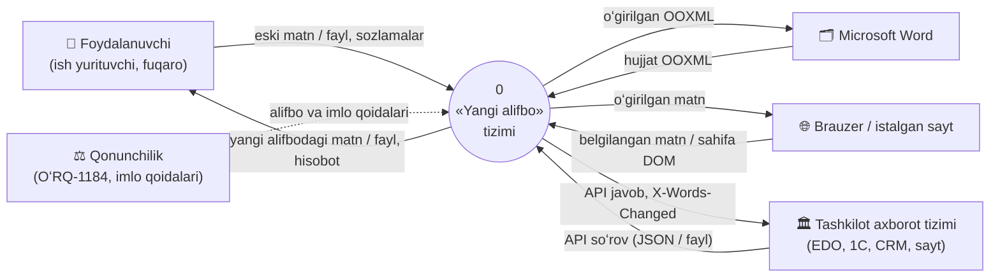

### 1.2. 1-daraja diagramma

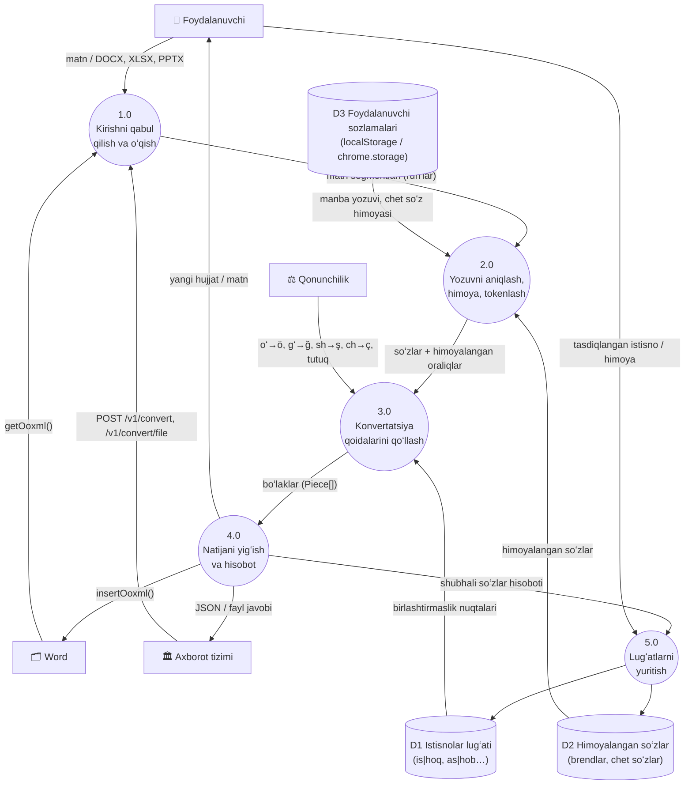

---

## 2. IDEF0 — funksional model

Strelkalar: **chapdan** — kirish (I), **yuqoridan** — boshqaruv (C), **oʻngga** — chiqish (O), **pastdan** — mexanizm (M).

### 2.1. A-0 — kontekst

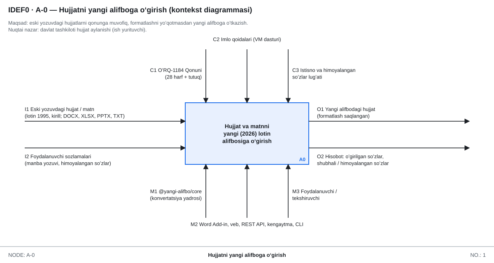

| Strelka | Mazmuni |
|---|---|
| I1 | Eski yozuvdagi hujjat yoki matn (lotin 1995, kirill; DOCX, XLSX, PPTX, TXT) |
| I2 | Foydalanuvchi sozlamalari |
| C1 | OʻRQ-1184 Qonuni — 28 harf + tutuq belgisi |
| C2 | Imlo qoidalari (Vazirlar Mahkamasi dasturi) |
| C3 | Istisno va himoyalangan soʻzlar lugʻati |
| O1 | Yangi alifbodagi hujjat (formatlash saqlangan) |
| O2 | Hisobot: oʻgirilgan, shubhali va himoyalangan soʻzlar |
| M1 | `@yangi-alifbo/core` — konvertatsiya yadrosi |
| M2 | Integratsiyalar: Word Add-in, veb-ilova, REST API, brauzer kengaytmasi, CLI |
| M3 | Foydalanuvchi / masʼul tekshiruvchi |

### 2.2. A0 — dekompozitsiya

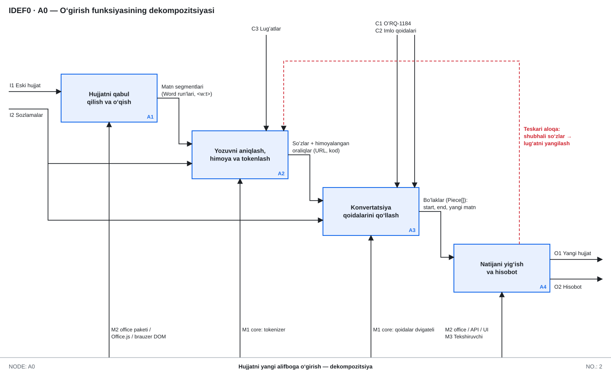

| Blok | Funksiya | Kodda |
|---|---|---|
| A1 | Hujjatni qabul qilish va oʻqish | `packages/office/src/xml.ts`, `apps/word-addin/src/word.ts`, `apps/extension/src/dom.ts` |
| A2 | Yozuvni aniqlash, himoya va tokenlash | `packages/core/src/engine.ts` → `buildPieces` (1–2-bosqich) |
| A3 | Konvertatsiya qoidalarini qoʻllash | `engine.ts` → `convertWord`, `convertCyrChar` |
| A4 | Natijani yigʻish va hisobot | `index.ts` → `convertSegments`, `convertWithReport`; `office` → ZIP |

---

## 3. BPMN 2.0 — biznes jarayon

**Jarayon:** davlat tashkilotida hujjatni yangi alifboga oʻtkazish. **Rollar (lane):** ish yurituvchi, «Yangi alifbo» tizimi, masʼul tekshiruvchi.

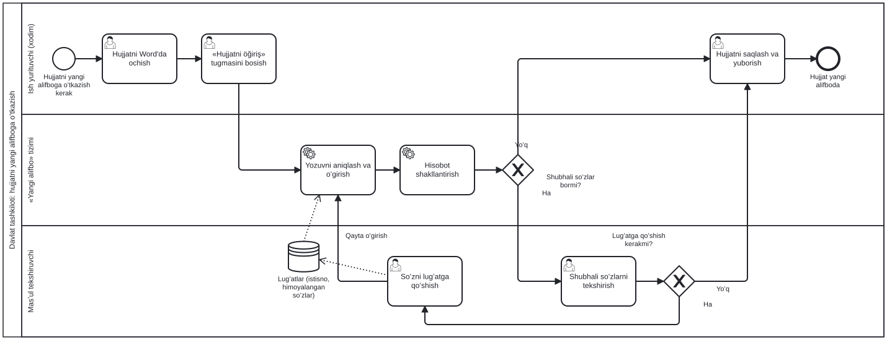

- Manba fayl: [`diagrams/bpmn-hujjat-otkazish.bpmn`](diagrams/bpmn-hujjat-otkazish.bpmn). Standart BPMN 2.0 XML formatida: [bpmn.io](https://demo.bpmn.io), Camunda Modeler va Bizagi'da ochiladi va tahrirlanadi.
- **Qaror nuqtalari:** «Shubhali soʻzlar bormi?» va «Lugʻatga qoʻshish kerakmi?».
- **Teskari aloqa sikli:** tekshiruvchi soʻzni lugʻatga qoʻshadi, hujjat qayta oʻgiriladi. Bu qadam keyingi barcha hujjatlarda aniqlikni oshiradi.

| Element | Turi | Bajaruvchi | Tizimdagi mos funksiya |
|---|---|---|---|
| Hujjatni Word'da ochish | User task | Ish yurituvchi | — |
| «Hujjatni öğiriş» tugmasini bosish | User task | Ish yurituvchi | Word lentasidagi tugma |
| Yozuvni aniqlash va oʻgirish | Service task | Tizim | `convertInWord()` → `convertXml()` |
| Hisobot shakllantirish | Service task | Tizim | `ConvertWarning[]` → panel |
| Shubhali soʻzlarni tekshirish | User task | Tekshiruvchi | Paneldagi roʻyxat (bosilganda soʻz belgilanadi) |
| Soʻzni lugʻatga qoʻshish | User task | Tekshiruvchi | Sozlamalar → «Oʻgirilmaydigan soʻzlar» |
| Hujjatni saqlash va yuborish | User task | Ish yurituvchi | — |

---

## 4. UML

### 4.1. Use case diagramma

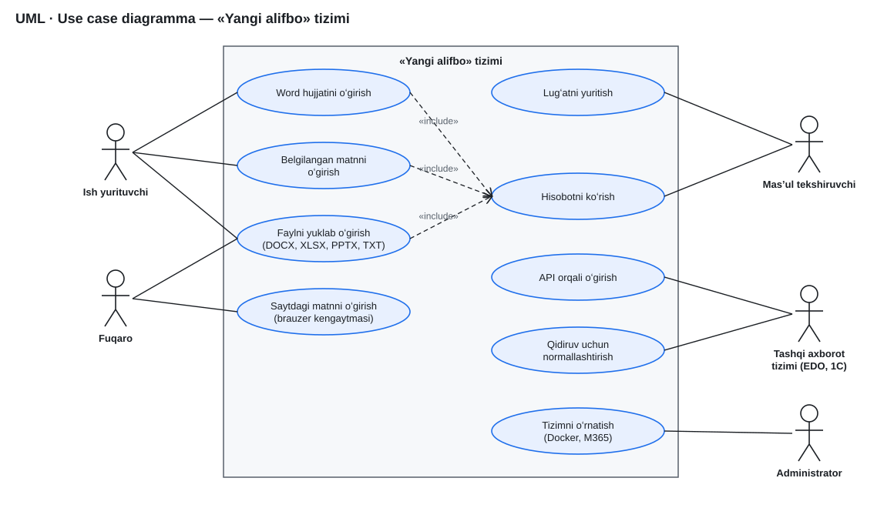

| Aktor | Holatlar (use case) |
|---|---|
| Ish yurituvchi | Word hujjatini oʻgirish, belgilangan matnni oʻgirish, faylni yuklab oʻgirish |
| Fuqaro | Faylni yuklab oʻgirish, saytdagi matnni oʻgirish |
| Masʼul tekshiruvchi | Hisobotni koʻrish, lugʻatni yuritish |
| Tashqi axborot tizimi | API orqali oʻgirish, qidiruv uchun normallashtirish |
| Administrator | Tizimni oʻrnatish (Docker, Microsoft 365) |

Oʻgirish holatlari «Hisobotni koʻrish» holatini **«include»** qiladi: har bir oʻgirishdan keyin hisobot shakllanadi.

### 4.2. Komponent diagramma

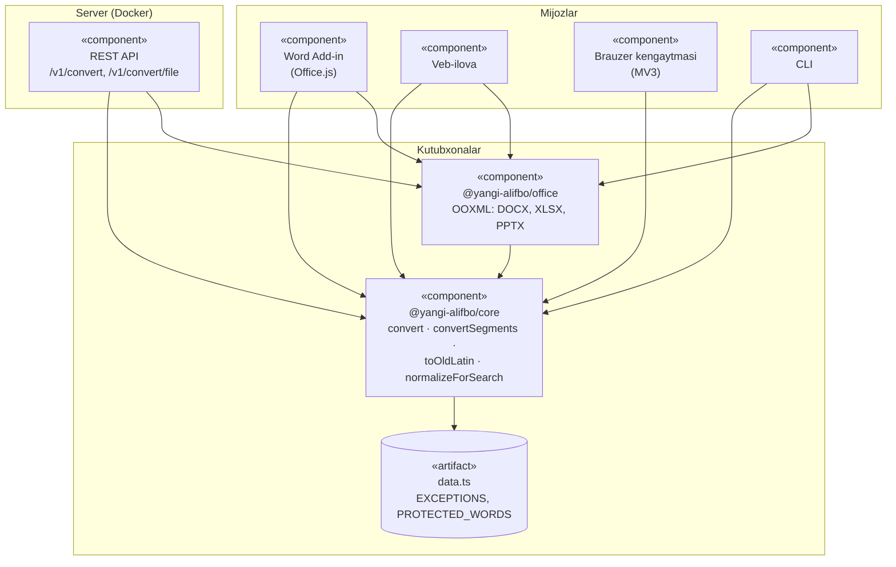

### 4.3. Ketma-ketlik: Word'da «Hujjatni öğiriş» tugmasi

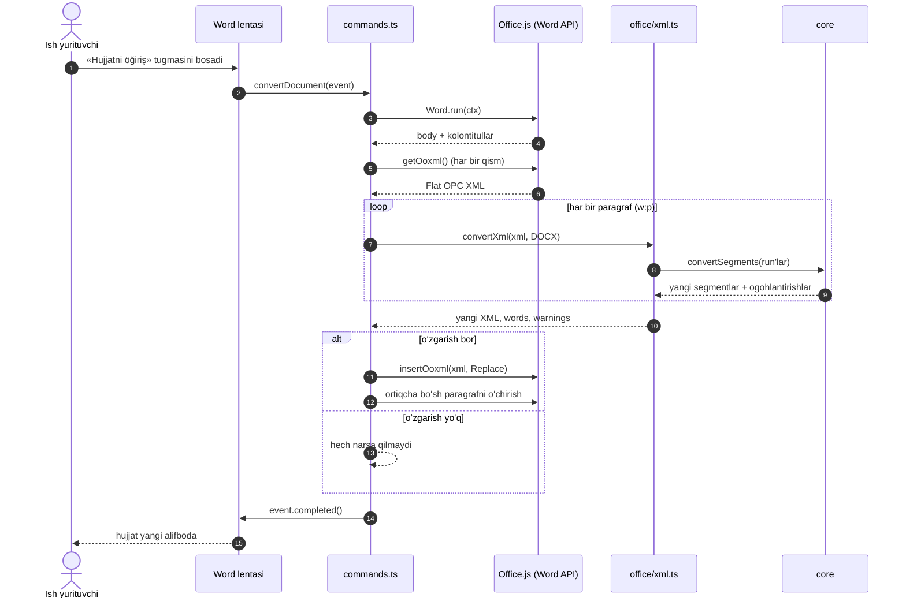

### 4.4. Ketma-ketlik: API orqali faylni oʻgirish

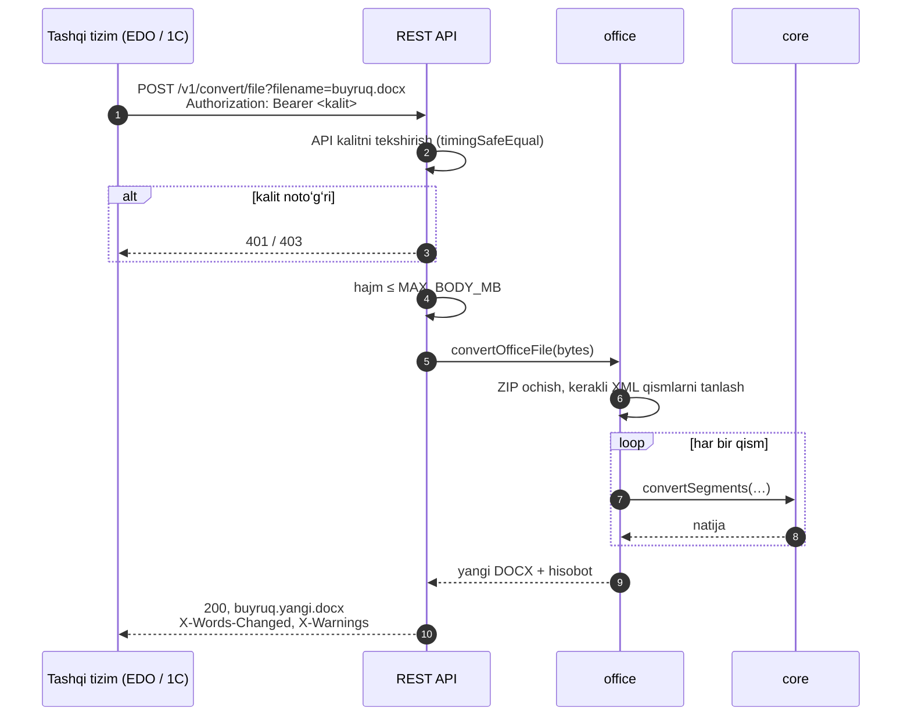

### 4.5. Sinf diagrammasi (core API)

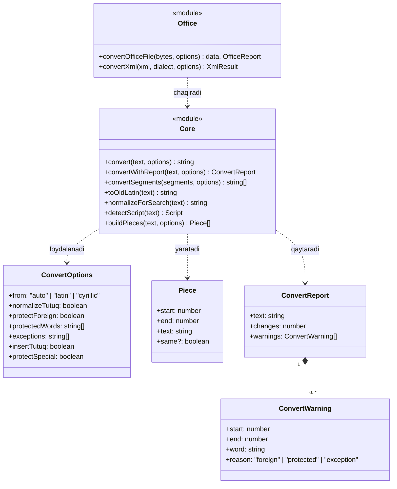

### 4.6. Holat diagrammasi: hujjatning hayot sikli

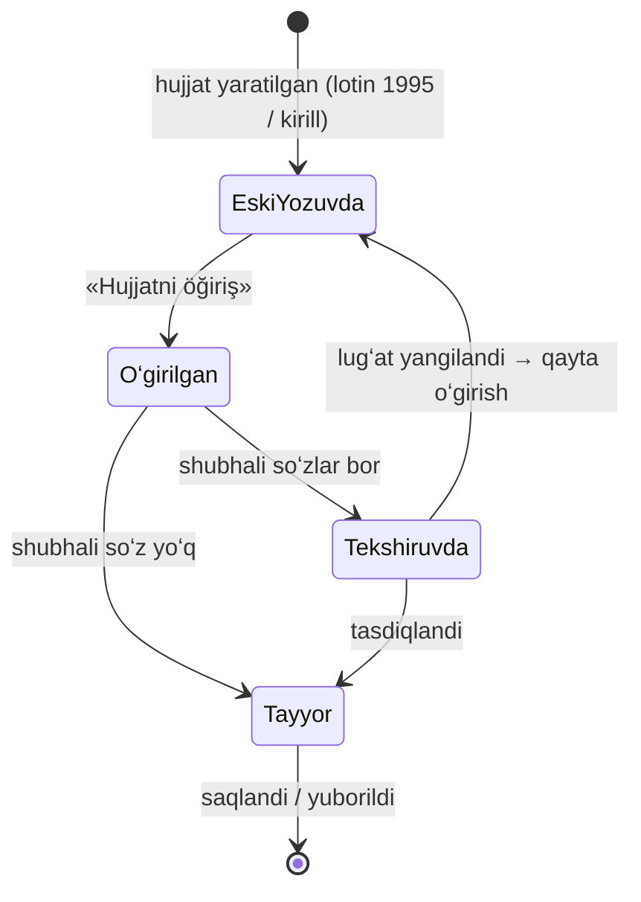

---

## 5. Sankey — oqim hajmi

Raqamlar `docs/korpus/` dagi 3 ta namuna hujjat (qaror, kirill xat, aralash yangilik — 304 soʻz) asosida **hisoblangan**:

```bash
node scripts/korpus-stats.mjs          # → docs/diagrams/sankey-data.json
# docs/diagrams/sankey.html — diagrammani qayta chizish va SVG eksport (d3-sankey)
```

> Sankey d3-sankey bilan chizilgan: Mermaid'ning `sankey-beta` moduli faqat ASCII belgilarni qabul qiladi, Ö Ğ Ş Ç va kirill harflarini koʻrsata olmaydi.

### 5.1. Soʻzlar: nimasi oʻgirildi, nimasi himoyalandi

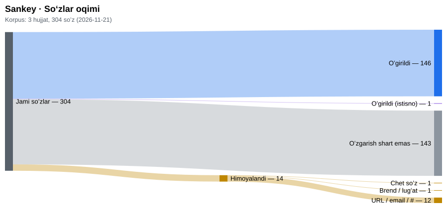

| Toifa | Soni | Ulushi |
|---|---:|---:|
| Oʻgirildi | 147 | 48,4 % |
| Oʻzgarish shart emas (oʻgiriladigan harf yoʻq) | 143 | 47,0 % |
| Himoyalandi (URL, email, hashtag, chet soʻz, brend) | 14 | 4,6 % |
| **Notoʻgʻri oʻgirilgan** (qoʻlda tekshirildi) | **0** | **0 %** |

**Yoʻqotishlar:** maʼlumot yoʻqolmaydi. Himoyalangan soʻzlar ataylab oʻzgarishsiz qoldiriladi va hisobotda koʻrsatiladi.

### 5.2. Harflar: eski → yangi

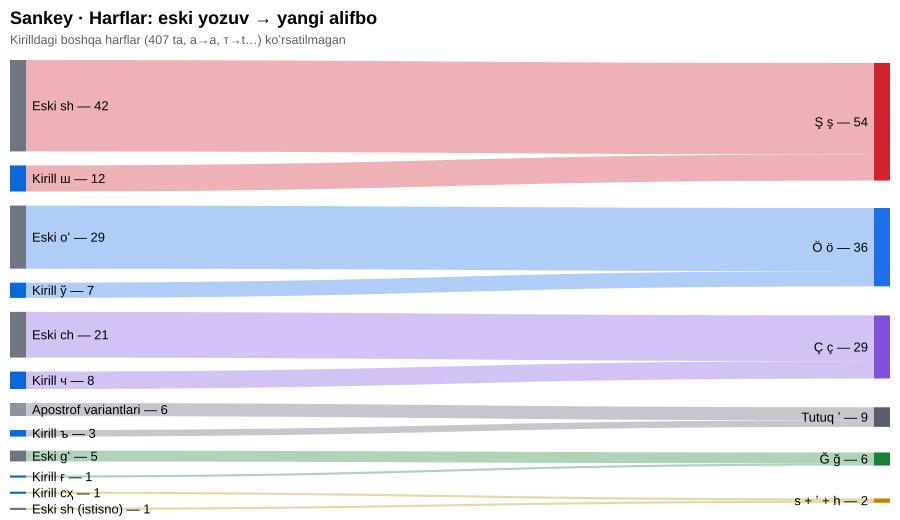

Bundan tashqari, kirilldagi boshqa harflar (а→a, т→t va hokazo) boʻyicha 407 ta almashinuv bor. Ular diagrammani bosib ketmasligi uchun koʻrsatilmagan.

---

## 6. Data lineage — maʼlumot kelib chiqishi

### 6.1. Word hujjati: fayldan hisobotgacha

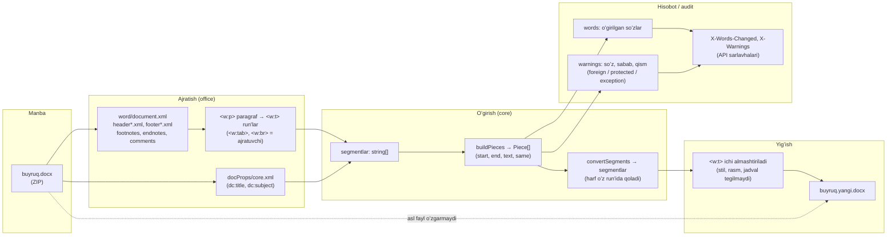

### 6.2. Maʼlumotlar bazasini koʻchirish (tavsiya etilgan sxema)

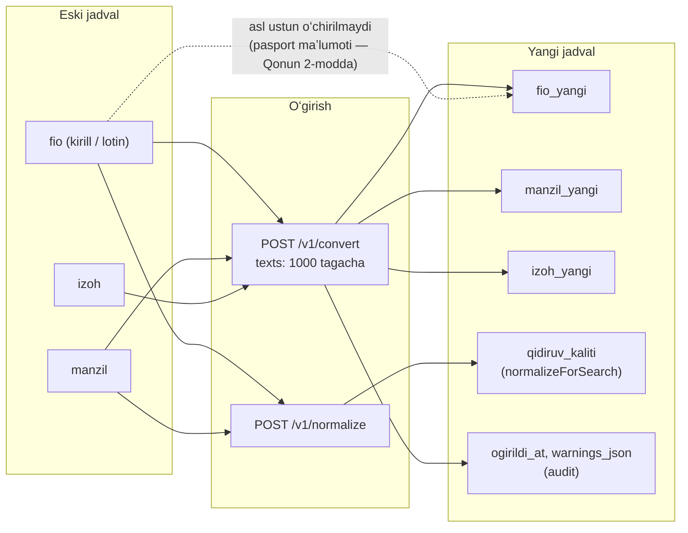

**Audit qoidalari:**
1. Asl ustunlar saqlanadi. Qonunning 2-moddasiga koʻra, eski yozuvdagi hujjatlar kuchida qoladi.
2. Har bir yozuv uchun oʻgirilgan vaqt va ogohlantirishlar (`warnings_json`) yoziladi.
3. Qidiruv `qidiruv_kaliti` boʻyicha olib boriladi, shunda `oʻzbek`, `ўзбек` va `özbek` bir xil topiladi.
